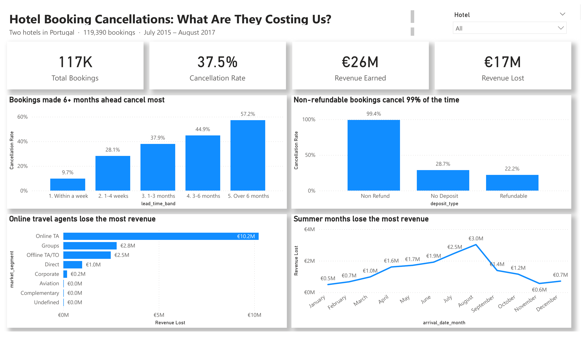

# Smith Cudjoe: Data & Business Analysis Portfolio

Two projects using SQL (SQLite) and Power BI. Each folder has its own README, SQL file, dashboard and project page.

| Project | Type | Business question | Folder |
|---|---|---|---|
| **Online Retail Analysis** | Data analysis | Who really pays the bills at a UK online gift shop? | [online-retail-analysis](online-retail-analysis/) |
| **Hotel Booking Cancellations** | Business analysis | Where are cancellations costing two hotels money, and which policy would protect the most revenue? | [hotel-cancellation-analysis](hotel-cancellation-analysis/) |

## Online Retail Analysis

Over one million transactions (Dec 2009 – Dec 2011) show that this "gift shop" is really a wholesale business: high-value orders, office-hour buying, almost no Saturday orders, and sales that peak every November.
→ [Read the project](online-retail-analysis/README.md)

## Hotel Booking Cancellations

A business analysis of 119,390 bookings at two hotels in Portugal: 37.5% were cancelled, putting up to €16.7M at risk. Bookings made far in advance and online travel agents drive the losses, and a deposit on bookings made more than 90 days ahead could protect about €0.8M a year.
→ [Read the project](hotel-cancellation-analysis/README.md)

## Tools
SQLite (DBeaver) · Power BI · Excel · GitHub Pages
