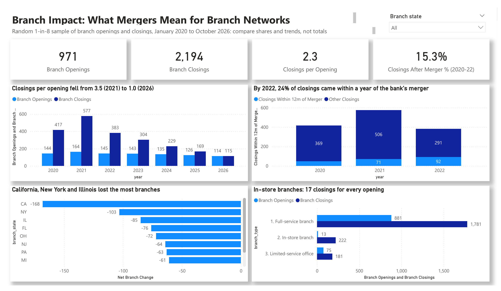

# US Bank Consolidation & Branch Impact: What Do Mergers Mean for Customers?

**A business analysis by Smith Cudjoe · SQL (SQLite) · Power BI**



A merger is the largest change programme a bank goes through: new systems, accounts moved to a new bank, and branches closed. As the business analyst, I used the FDIC's official record of bank structure changes to find out how fast US banks are consolidating, who is buying whom, and what mergers mean for branch networks and the customers who use them. I checked what the data really contained, cleaned it in SQL, answered 19 business questions, and built a four-page Power BI dashboard ending in a merger integration readiness checklist.

📄 [Project brief](Project_Brief.md) · 🗂️ [SQL analysis](Bankconsolidationanalysis.sql) · 📊 [Dashboard (PDF)](Bank_Consolidation_Dashboard.pdf) · 💾 [Power BI template](Bank_Consolidation_Dashboard.pbit)

---

## At a glance

| Banks absorbed in mergers | Net change in banks | Branches moved to a new bank | Branch closings after a merger |
|:---:|:---:|:---:|:---:|
| **361** | **−357** | **4,800** | **+81%** |

*Mergers, banks and branches moved: January 2020 to September 2022. Branch closings: buyers' closings in the 12 months after their first merger compared with the 12 months before.*

---

## 1. The business problem
When two banks merge, every account, card, loan and branch of the absorbed bank has to move to the buyer. Data has to be migrated and reconciled, systems cut over, and branches are often closed. A bank's change and integration leadership asked:
- **How fast** are US banks consolidating, and which kinds of change are increasing?
- **Who** is buying whom?
- **What** do mergers mean for branch networks and the customers who use them?

## 2. Stakeholders
| Stakeholder | What they need |
|---|---|
| Integration programme director | How big and how frequent merger programmes are |
| Head of branch network | When and where branches close after a merger |
| Operations & reconciliation leads | What has to be migrated and reconciled at cutover |
| Compliance & customer experience | Closure notices, customer impact and complaints |

## 3. KPIs
| KPI | Definition |
|---|---|
| Mergers | Banks absorbed into another bank (one per bank and date, de-duplicated) |
| Net change in banks | New banks − mergers − failures − voluntary closings |
| Branches acquired | Branches that moved to the buyer in a merger |
| Closings per opening | Branch closings ÷ branch openings |
| Closings after merger | Branch closings within 12 months after the bank completed a merger as the buyer |

---

## 4. Findings

| # | Business question | Answer |
|---|---|---|
| 1 | How fast are banks consolidating? | FDIC-insured banks fell by a net 357 in 33 months: 361 mergers, 4 failures and 20 voluntary closings against only 28 new banks |
| 2 | Is consolidation speeding up? | Fewer deals, but bigger ones: January to September mergers fell from 134 (2020) to 76 (2022), while branches per merger rose from 8.4 to 19.2 |
| 3 | Who is buying whom? | 85% of mergers were commercial banks buying commercial banks. 68% moved five branches or fewer |
| 4 | Where is the customer impact? | Just 9 deals (2.5% of mergers) moved half of the 4,800 acquired branches, led by PNC–BBVA USA (644) and Huntington–TCF (506) |
| 5 | Where are banks absorbed? | Texas (28) and Illinois (23). In Tennessee and New York, nearly half of buyers came from another state |
| 6 | Is the branch network shrinking? | Yes, but more slowly: 3.5 closings per opening in 2021, falling to 1.0 in 2026 |
| 7 | Do mergers cause closures? | Buyers closed 81% more branches in the year after a merger, while openings stayed flat |
| 8 | How much of the closing is merger-driven? | The share of closings within a year of the bank's merger doubled, from 11.5% in 2020 to 24.0% in 2022 |
| 9 | Which branches are customers losing? | In-store branches (in supermarkets and shops): 17 closings for every opening, against 2 for full-service branches |

### Understanding the data before analysing it
The FDIC download stops at **exactly 10,000 rows**, so the file is an extract, not every event since 2020. Before drawing any conclusions I worked out what it contained (SQL questions Q1 and Q1b):

- **Bank-level records** (mergers, failures, new banks, charter and name changes) have IDs like `202000025_223_…`. They are **complete** for everything the FDIC processed up to 19 October 2022, so I analysed them for **January 2020 to September 2022**.
- **Branch-level records** (openings, closings, branches moving in a merger) have random 32-character IDs. The file holds every ID starting `00` to `1f`, which is **1 in 8** of all possible IDs. Because the IDs are random, this is a fair **one-in-eight sample**, at the same rate every year, from 2020 to October 2026. Totals are understated, so I compared **shares and trends**, not totals.

### How I cleaned it
- **Translated the change codes** into ten readable groups (merger, failure, new bank, branch opening, branch closing and so on).
- **De-duplicated mergers:** the FDIC records every merger from both sides, so 795 merger rows became 361 mergers (one per absorbed bank and date).
- **Joined on CERT, never on name:** a bank keeps its FDIC certificate number (CERT) when it changes its name. CenterState Bank became SouthState Bank under the same CERT, and one bank name even appears with a double space.
- **Removed credit unions** (19% of rows): they are insured by the NCUA, not the FDIC, so they are not banks for this question.
- **Removed late records:** some changes from as far back as 1934 were only recorded after 2020.
- **Matched branches on the FDIC's unique branch number**, so a branch closing can be linked to the bank's merger.

---

## 5. Recommendations: merger integration readiness
1. **Reconcile before cutover:** reconcile every account and balance daily in the final weeks, and match records on stable IDs (account number, CERT, branch number), never on names.
2. **Plan the first 12 months:** that is when post-merger closures cluster, so branch decisions and customer notices should be planned before the merger completes.
3. **Protect the customers most at risk:** give at least 90 days' notice of a closure, name the nearest branch, ATM and digital options, and give extra support to customers of in-store and rural branches.
4. **Test the cutover:** test payments, cards and online banking end to end with converted data, with clear go/no-go criteria and a rollback plan.
5. **Measure the customer impact:** track complaints in the 90 days after the merger against the 90 days before. This links to my [Consumer Complaints](../consumer-complaints-analysis/) project.

**KPIs to track:** accounts reconciled before cutover (target 100%) · open reconciliation breaks at go/no-go (target 0) · closure notices sent 90+ days ahead (target 100%) · complaints in the 90 days after the merger (no rise) · customers who leave within 12 months (at or below the pre-merger rate).

---

## Method
1. **Brief:** problem, stakeholders, questions and KPIs ([Project_Brief.md](Project_Brief.md)).
2. **Check (SQL):** work out what the 10,000-row extract contains and which periods are complete.
3. **Clean (SQL):** label every row with a data check, then build three tables: `events`, `mergers` (de-duplicated) and a flag for closings after a merger.
4. **Analyse (SQL):** 19 business questions using `COUNT`, `SUM`, `CASE`, `GROUP BY` and simple joins.
5. **Present (Power BI):** four pages: Change Overview, Consolidation, Branch Impact and Recommendation.

**To open the dashboard:** open `Bank_Consolidation_Dashboard.pbit` in Power BI Desktop and enter the full path of the folder that holds `events.csv` and `mergers.csv` when asked. These two files are the tables created by the SQL script.

## Caveats
- The download stops at 10,000 rows, so this is an extract of the FDIC history, not the full record.
- Bank-level records are complete only for January 2020 to September 2022, so the 2023 bank failures fall outside the analysis.
- Branch records are a random one-in-eight sample: counts understate the true totals, but shares and trends between years are fair.
- A closing within 12 months of a merger is linked to the merger by timing, which does not prove the merger caused it.
- Data: [FDIC BankFind Suite](https://banks.data.fdic.gov), structure change history ([API documentation](https://api.fdic.gov/banks/docs/)).

## Files
```
├── index.html                          <- project page (GitHub Pages)
├── README.md                           <- this page
├── Project_Brief.md                    <- business analyst project brief
├── Bankconsolidationanalysis.sql       <- SQL analysis with results
├── Bank_Consolidation_Dashboard.pbit   <- Power BI template
├── Bank_Consolidation_Dashboard.pdf    <- dashboard as PDF
├── fdic_history.csv                    <- the data (10,000 FDIC records)
├── events.csv                          <- clean events table (from the SQL)
├── mergers.csv                         <- de-duplicated mergers (from the SQL)
├── dashboard.png                       <- dashboard screenshot
├── sql_preview.png                     <- SQL preview image
└── powerbi_preview.png                 <- Power BI preview image
```
