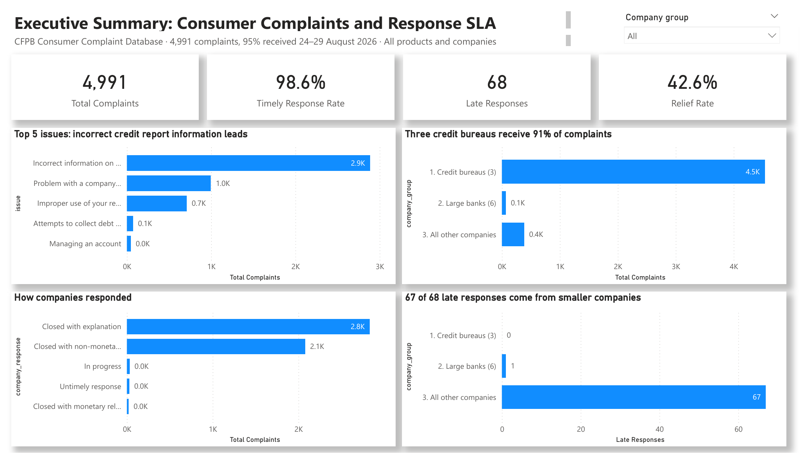

# Consumer Complaints & Response SLA: Where Should Operations Focus First?

**A business analysis by Smith Cudjoe · SQL (SQLite) · Power BI**



Companies must respond to complaints forwarded by the US regulator, the Consumer Financial Protection Bureau (CFPB), within 15 days. As the business analyst, I defined the problem, stakeholders, KPIs and peer groups, analysed 4,991 complaints in SQL, and built a four-page Power BI dashboard showing what drives complaints and late responses, and where operations should focus first.

📄 [Project brief](Project_Brief.md) · 🗂️ [SQL analysis](Bankcomplaintsanalysis.sql) · 📊 [Dashboard (PDF)](Consumer_Complaints_Dashboard.pdf) · 💾 [Power BI template](Consumer_Complaints_Dashboard.pbit)

---

## At a glance

| Complaints | Timely response rate (SLA) | Late responses | Relief rate |
|:---:|:---:|:---:|:---:|
| **4,991** | **98.6%** | **68** | **42.6%** |

---

## 1. The business problem
Every complaint forwarded by the CFPB starts a 15-day clock. A late response is a missed SLA and a regulatory risk, and a complaint where the company has to give money back or fix something points to a process error. The operations leader asked:
- **What** drives complaints and late responses?
- **How** do companies compare with their peers?
- **Where** should operations focus first?

## 2. Stakeholders
| Stakeholder | What they need |
|---|---|
| Head of Operations | What to fix first |
| Complaints team leads | Which products and issues miss the 15-day SLA |
| Compliance & Risk | SLA performance against peers |
| Product owners | The root causes behind their products' complaints |

## 3. KPIs
| KPI | Definition |
|---|---|
| Complaints | Number of complaints received |
| Timely response rate | Complaints answered on time ÷ all complaints |
| Late responses | Complaints not answered on time |
| Relief rate | Closed complaints where the company gave money or another fix ÷ all closed complaints |

---

## 4. Findings

| # | Business question | Answer |
|---|---|---|
| 1 | How big is the problem? | 4,991 complaints, 98.6% on time, 68 late, relief in 42.6% of closed complaints |
| 2 | What drives the volume? | Credit reporting: 92.5% of complaints |
| 3 | What is the top issue? | "Incorrect information on your report": 58% of all complaints |
| 4 | What is the root cause? | In 36% of all complaints the information belongs to someone else |
| 5 | Where are the late responses? | Debt collection (28 late) and student loans (7 of 10 late) |
| 6 | How do peers compare? | Credit bureaus 100% on time · Large banks 98.6% · Other companies 82.6% |
| 7 | Who misses the SLA? | Smaller companies: 7.7% of complaints but 67 of 68 late responses |
| 8 | Which issue is late most often? | Threatened legal action: late 14 times out of 26 |

### Comparing fairly
The CFPB says complaint data is not a statistical sample, and that volume should be read in the context of company size. So companies were grouped into **credit bureaus (3)**, **large banks (6)** and **all other companies**, and compared on **rates, not counts**. This revealed that the smallest group by volume caused almost all the late responses.

---

## 5. Recommendations
1. **Fix the biggest driver at its source:** improve identity matching between lenders and credit bureaus so information is not reported on the wrong person.
2. **Protect the SLA where it fails:** track debt collection and student loan complaints daily.
3. **Create a specialist route:** send complaints about threatened legal action to a specialist team with a 10-day internal target.
4. **Use relief as an early warning:** review monthly the issues where companies most often had to fix something.
5. **Confirm with more data:** re-run on two to three years of data for a bank peer group.

---

## Method
1. **Brief:** problem, stakeholders, questions, KPIs, peer groups ([Project_Brief.md](Project_Brief.md)).
2. **Clean (SQL):** convert dates, assign peer groups, add 1/0 flags for timely, late and relief.
3. **Analyse (SQL):** nine business questions using `COUNT`, `SUM`, `CASE` and `GROUP BY`.
4. **Present (Power BI):** four pages: Executive Summary, Root Cause, Company vs Peer, Recommendations.

**To open the dashboard:** open `Consumer_Complaints_Dashboard.pbit` in Power BI Desktop and enter the full path to `Complaint_concise.csv` when asked.

## Caveats
- The CFPB data is not a statistical sample of all customer experiences.
- 95% of complaints were received 24–29 August 2026, so this is a snapshot, not a long-term trend.
- The CFPB changed its product and issue categories in April 2017; only recent data is used.
- 32 complaints were still in progress when the data was exported.
- Data: [CFPB Consumer Complaint Database](https://www.consumerfinance.gov/data-research/consumer-complaints/).

## Files
```
├── index.html                           <- project page (GitHub Pages)
├── README.md                            <- this page
├── Project_Brief.md                     <- business analyst project brief
├── Bankcomplaintsanalysis.sql           <- SQL analysis with results
├── Consumer_Complaints_Dashboard.pbit   <- Power BI template
├── Consumer_Complaints_Dashboard.pdf    <- dashboard as PDF
├── Complaint_concise.csv                <- the data (4,991 complaints)
├── dashboard.png                        <- dashboard screenshot
├── sql_preview.png                      <- SQL preview image
└── powerbi_preview.png                  <- Power BI preview image
```
