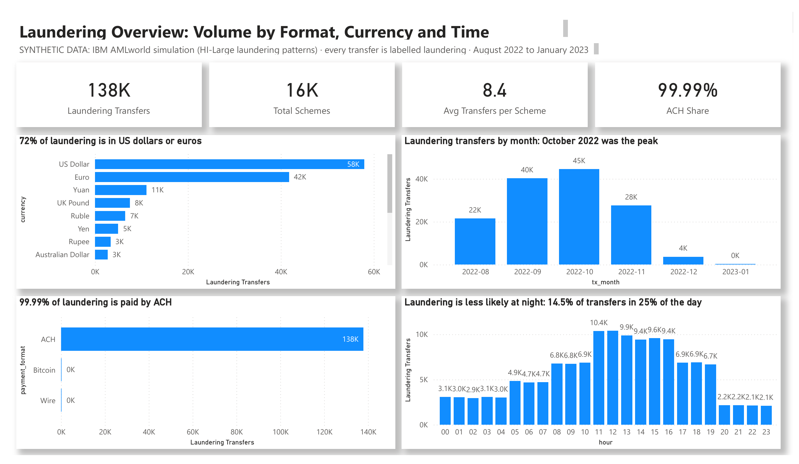

# Financial Crime Analytics: Which Monitoring Rules Earn Their Alerts?

**A financial crime analytics project by Smith Cudjoe · SQL (SQLite) · Power BI**

> ⚠️ **Synthetic data.** This project uses the IBM Transactions for Anti-Money Laundering dataset (AMLworld). IBM simulated a whole financial system of banks, companies and individuals, because real labelled money-laundering data cannot be published. There are no real people, banks or accounts.



Transaction monitoring rules raise alerts that analysts must review. Too few rules miss laundering; too many bury the team in alerts. Because every laundering transfer in the IBM data is labelled, it is possible to measure how well a control actually works. I tested six simple monitoring rules on 137,936 laundering transfers in 16,467 schemes, measured what each rule catches and how many alerts it costs, and built a four-page Power BI dashboard ending in a rule-tuning plan.

📄 [Project brief](Project_Brief.md) · 🗂️ [SQL analysis](Amlrulesanalysis.sql) · 📊 [Dashboard (PDF)](Financial_Crime_Dashboard.pdf) · 💾 [Power BI template](Financial_Crime_Dashboard.pbit)

---

## At a glance

| Laundering schemes | Detected by the six rules | Alerts saved by tuning | Detection given up |
|:---:|:---:|:---:|:---:|
| **16,467** | **97.2%** | **37%** | **0.9 points** |

---

## 1. The business problem
A financial crime operations lead asked:
- **Which** simple monitoring rules catch the most laundering for the fewest alerts?
- **Which** rules should be tightened or retired to reduce analyst workload?
- **What** laundering slips through every rule?

## 2. Stakeholders
| Stakeholder | What they need |
|---|---|
| Head of financial crime operations | Fewer alerts without losing coverage |
| Transaction monitoring analysts | Rules whose alerts are worth reviewing |
| Compliance (MLRO) | Evidence that coverage stays high after tuning |
| Rule governance | A documented case for each rule change |

## 3. The six rules tested
| Rule | Fires when |
|---|---|
| R1 Large transfer | the amount is $10,000 or more |
| R2 Just below $10k | the amount is $9,000 to $9,999.99 (possible structuring) |
| R3 Many senders | the receiving account is paid by 5+ different accounts |
| R4 Many receivers | the sending account pays 5+ different accounts |
| R5 Night-time | the transfer is sent between midnight and 6am |
| R6 Foreign currency | the transfer is not in US dollars |

## 4. KPIs
| KPI | Definition |
|---|---|
| Alerts | Transfers flagged by a rule |
| Scheme detection rate | Schemes with at least one alert ÷ all schemes |
| Alerts per scheme | Alerts ÷ schemes detected (analyst workload) |
| Unique schemes | Schemes that only this rule detects (what the rule adds) |

---

## 5. Findings

| # | Business question | Answer |
|---|---|---|
| 1 | What does laundering look like? | Eight patterns of about 2,000 schemes each. 72% of laundering is in US dollars or euros, and 99.99% is paid by ACH |
| 2 | Is there structuring below $10,000? | No: the $9k–$10k band holds 5.3% of transfers, the same as each $1k band below it |
| 3 | When does laundering happen? | Mostly by day: only 14.5% of transfers happen at night, which is 25% of the day |
| 4 | How well do the rules work together? | They detect 97.2% of schemes. The 460 they miss are tiny, mostly one or two transfers |
| 5 | Which rules do the most work? | R6 (foreign currency) detects 82% of schemes and R1 (large transfer) 77%, and each catches hundreds that no other rule does |
| 6 | Which rules cost the most work? | R3 and R4 raise 8.3 alerts for every scheme they detect, yet catch only 17 schemes each that no other rule catches |
| 7 | Should R1 be tightened? | No: at $25,000 it would detect 15% of schemes instead of 77% |
| 8 | What does tuning achieve? | Retiring R2, R3 and R4 cuts alerts by 37% (262,703 to 164,775) while detection falls only from 97.2% to 96.3% |

### What this data can and cannot show
The file I used is IBM's companion **patterns file**: it holds only the laundering transfers, grouped into schemes such as fan-in, fan-out and cycle. So it measures **what each rule catches** and **how many alerts it raises per scheme**, but **not false alerts** on normal payments, and not laundering *rates* by currency or format, because there are no normal payments to compare with. Measuring false alerts on the full transactions file is the first step in the tuning plan.

### How I cleaned it
- **Turned a text report into a table:** the patterns file wraps each scheme in BEGIN and END lines. A short script ([prepare_patterns.py](prepare_patterns.py)) adds a scheme ID and pattern name to each transfer and saves it as a CSV.
- **Caught an import error:** account IDs such as `800E49350` look like numbers in scientific notation. On the first import, DBeaver read 4,419 of them as numbers, merging them into 1,862 values and inflating R3 and R4. Importing the account columns as text fixed it, and a one-line check (Step 0b in the SQL) now confirms it on every run.
- **Converted 15 currencies to US dollars** with approximate September 2022 rates, so one $10,000 threshold works for every transfer.
- **Counted transfers, not value:** 1,959 simulated transfers are over $10 million, so totals in dollars would be meaningless.
- **No sampling needed:** the brief suggested keeping all laundering rows plus a sample of normal ones. This file has no normal rows, and at 137,936 rows it loads easily in Power BI.

---

## 6. Recommended rule-tuning plan
1. **Retire R3 and R4 (many senders, many receivers):** the heaviest workload, with almost nothing unique.
2. **Retire R2 (just below $10k):** there is no structuring in the data, and it catches only 59 unique schemes.
3. **Keep R1 at $10,000:** a higher threshold would miss most schemes.
4. **Test R5 (night-time) and R6 (foreign currency) for false alerts** on the full transactions file before relying on them: both are broad rules that may also flag many normal payments.
5. **Track the KPIs monthly:** scheme detection rate (target 96% or higher), alerts per scheme detected (target down by a third), and the false-alert rate once normal payments are included.

---

## Method
1. **Brief:** problem, stakeholders, rules and KPIs ([Project_Brief.md](Project_Brief.md)).
2. **Prepare:** convert the patterns text file to a CSV.
3. **Clean (SQL):** check the import, convert currencies, add amount bands and hours.
4. **Analyse (SQL):** run six rules with `CASE` and simple `GROUP BY` counts, then 13 business questions using `COUNT`, `SUM`, `GROUP BY` and `UNION ALL`.
5. **Present (Power BI):** four pages: Laundering Overview, Laundering Patterns, Rule Performance and Rule Tuning Plan.

**To open the dashboard:** open `Financial_Crime_Dashboard.pbit` in Power BI Desktop and enter the full path of this folder when asked. It reads the seven CSVs created by the SQL script.

## Caveats
- The data is synthetic: patterns from a simulation may not match real laundering.
- The file holds only laundering, so false alerts and laundering rates cannot be measured here.
- R3 and R4 count senders and receivers among laundering transfers only; on real data, normal payments would add to these counts.
- Exchange rates are approximate.
- Data: [IBM Transactions for Anti-Money Laundering (Kaggle)](https://www.kaggle.com/datasets/ealtman2019/ibm-transactions-for-anti-money-laundering-aml), HI-Large patterns file.

## Files
```
├── index.html                       <- project page (GitHub Pages)
├── README.md                        <- this page
├── Project_Brief.md                 <- project brief
├── Amlrulesanalysis.sql             <- SQL analysis with results
├── Financial_Crime_Dashboard.pbit   <- Power BI template
├── Financial_Crime_Dashboard.pdf    <- dashboard as PDF
├── HI-Large_Patterns.txt            <- original IBM patterns file
├── prepare_patterns.py              <- turns the text file into a CSV
├── laundering_patterns.csv          <- the data (137,936 transfers)
├── alerts.csv, schemes.csv, rule_performance.csv, unique_schemes.csv,
│   rule_pattern_coverage.csv, threshold_tuning.csv, rule_sets.csv
│                                    <- tables created by the SQL (for Power BI)
├── dashboard.png                    <- dashboard screenshot
├── sql_preview.png                  <- SQL preview image
└── powerbi_preview.png              <- Power BI preview image
```
