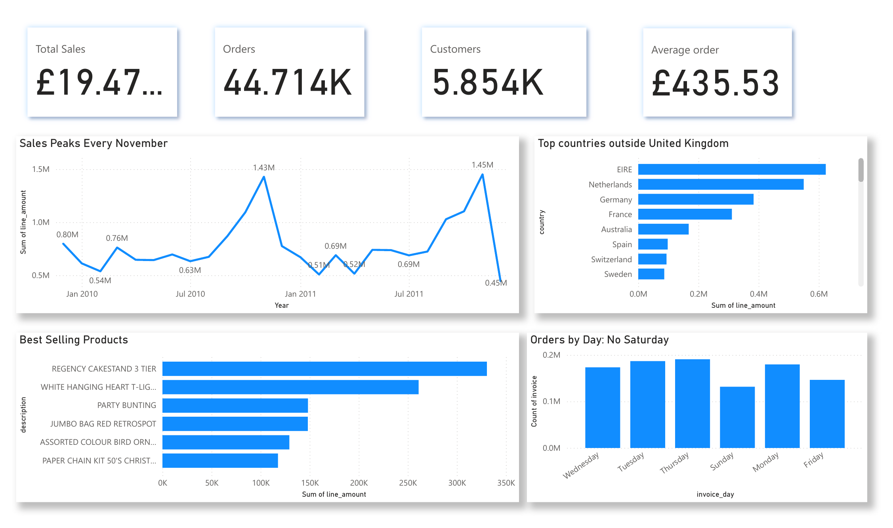

# Online Retail Analysis: Who Really Pays the Bills?

**By Smith Cudjoe**

**SQL (SQLite) · Power BI · December 2009 – December 2011**



A UK online gift shop sold £19.47 million in two years. But who were its customers, when did they buy, and what kept the business going? I analysed over one million transactions with SQL and built a Power BI dashboard to find out.

**The answer:** this "gift shop" is really a wholesale business that depends on a small group of customers and one busy season.

📄 [View the SQL](Onlineretailanalysis.sql) · 📊 [Dashboard (PDF)](PBI_Online_Retail_Analysis.pdf) · 💾 [Power BI file](PBI_Online_Retail_Analysis.pbix)

---

## At a glance

| Total sales | Orders | Customers | Average order |
|:---:|:---:|:---:|:---:|
| **£19.47M** | **44,714** | **5,854** | **£435.53** |

*43 countries. Figures exclude one mistaken 80,995-unit order (see Question 8).*

---

## The project

| | |
|---|---|
| **Business question** | Where does the money really come from? |
| **Data** | [Online Retail II](https://archive.ics.uci.edu/dataset/502/online+retail+ii), UCI Machine Learning Repository. 1,033,036 transaction lines after cleaning. |
| **Tools** | Excel (preparation), SQLite in DBeaver (cleaning and analysis), Power BI (dashboard) |
| **Approach** | Clean the data → keep only real sales → answer 11 business questions in SQL → show the answers in one dashboard |

---

## Key findings

### 1. This "gift shop" is really a wholesale business
The average order is £435.53, far too high for people buying presents for themselves. Customers order in office hours (mostly 10:00–15:00), and the shop takes almost no orders on Saturdays. These are shops buying stock to resell.

### 2. Christmas decides the year
The five best months in the data are all September, October or November. November is the peak in both years, at about £1.4M, as shops stock up for the holidays.

### 3. A few customers carry the business
Just 10 customers spent about £2.7M, around 14% of all sales. The top customer alone spent £581K.

### 4. Overseas, a few accounts act like distributors
The UK brings in 86% of sales, but Ireland is the second-biggest market with only 3 customers. Dutch orders average £2,545, five times the UK average.

### 5. Always question the top 10
The third "best-selling" product was a single order of 80,995 paper craft kits, cancelled 12 minutes later. It was almost certainly a typing mistake, so the dashboard leaves it out.

---

## The analysis in SQL

All queries are in [`Onlineretailanalysis.sql`](Onlineretailanalysis.sql), each with a comment explaining the finding.

| # | Question | SQL used | Finding |
|---|---|---|---|
| 1 | How big is the business? | `SUM`, `COUNT(DISTINCT)` | Total sales, orders, customers and countries |
| 2 | Sales by year | `strftime`, `GROUP BY` | 2011 sold slightly more than 2010 with fewer orders |
| 3 | Best months | `ORDER BY`, `LIMIT` | Top 5 months are all Sep–Nov |
| 4 | Top countries | `GROUP BY` | UK = 86%; Ireland #2 with 3 customers |
| 5 | Countries with the biggest orders | `HAVING` | Netherlands: £2,545 per order |
| 6 | Top 10 customers | `WHERE`, `LIMIT` | 10 customers ≈ 14% of sales |
| 7 | Best-selling products | `SUM`, `ORDER BY` | Regency cakestand leads (£331K) |
| 8 | The order that never happened | `LIKE` | 80,995 units cancelled after 12 minutes |
| 9 | Which day do customers order? | `strftime('%w')` | Thursday busiest; only 30 Saturday orders |
| 10 | Which hour do customers order? | `strftime('%H')` | Peak at 12:00, office hours |
| 11 | How much was cancelled? | `WHERE` | 8,292 cancelled invoices worth £1.46M |

Example: finding the busiest day of the week

```sql
SELECT strftime('%w', invoice_date)  AS day_of_week,     -- 0 = Sunday, 6 = Saturday
       COUNT(DISTINCT invoice)       AS orders
FROM sales
GROUP BY day_of_week;
-- Thursday is the busiest day (8,167 orders).
-- Saturday has only 30 orders in two years, while Sunday has 4,824.
```

*The SQL figures include the mistaken order, because it is only discovered in Question 8.*

---

## The dashboard

| Visual | What it shows |
|---|---|
| Four KPI cards | Total sales, orders, customers and average order value |
| Sales peaks every November | Monthly sales with the same autumn peak in both years (Dec 2011 is low because the data ends on the 9th) |
| Top countries outside the UK | Ireland, the Netherlands and Germany lead overseas |
| Best-selling products | The Regency cakestand and the white hanging heart T-light holder lead |
| Orders by day | Thursday is busiest; almost nothing on Saturday |

---

## Recommendations

1. **Look after the top customers.** A handful of accounts bring in a large share of sales. Give them a named contact and early access to new stock.
2. **Prepare for autumn early.** Stock up on best sellers before September, when the busiest three months begin.
3. **Grow the overseas accounts.** Ireland and the Netherlands show that a few large international customers can be worth more than whole countries.
4. **Check unusual orders.** Flag any order far larger than a customer's normal size before it is processed.

---

## Notes on the data
- About 23% of transaction lines have no customer ID. They count toward sales but not toward customer numbers.
- December 2011 is a partial month; the data ends on 9 December 2011.
- Cancelled orders, postage and fee lines, and zero-price lines were removed before the analysis.
- The raw data is not stored here because of its size. Download it from the [UCI Machine Learning Repository](https://archive.ics.uci.edu/dataset/502/online+retail+ii).

## Files

```
├── index.html                        <- project report (GitHub Pages)
├── README.md                         <- this page
├── Onlineretailanalysis.sql          <- all SQL queries with comments
├── dashboard.png                     <- dashboard screenshot
├── sql_preview.png                   <- SQL preview image
├── powerbi_preview.png               <- Power BI preview image
├── PBI_Online_Retail_Analysis.pbix   <- Power BI file
└── PBI_Online_Retail_Analysis.pdf    <- dashboard as PDF
```
